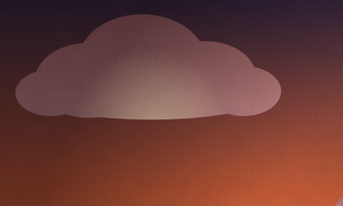
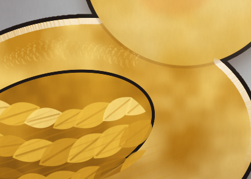
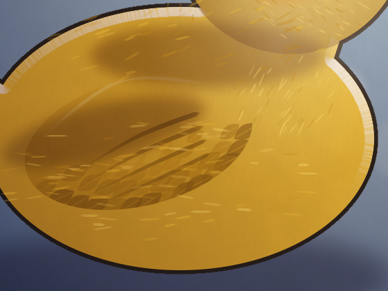
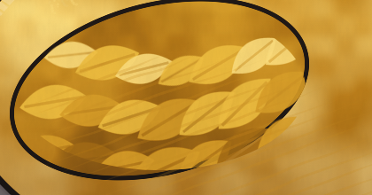
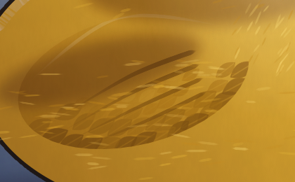
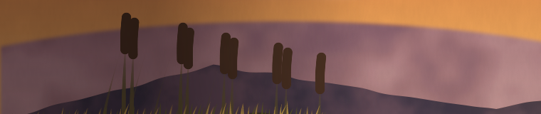
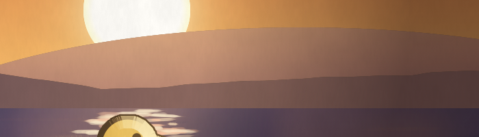
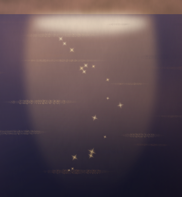
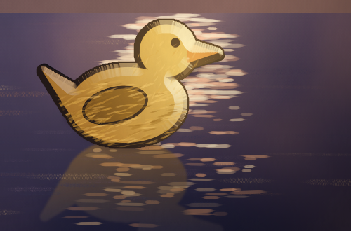

# Mistakes

Real ones, from the gallery pieces, each with a before picture and an after picture (close-ups,
in `mistakes/`; the afters are from the phase 4 repaints `gallery/sunset-pond-v3` and
`gallery/duck-portrait-v2`), what was wrong in one line and the fix in one line. The critique's
finding for each is quoted, so a painter can recognise the same mistake from the numbers, and
what the critique says after the fix.

## Smudge clouds (sunset pond)

- **Wrong:** a noise fill with transparent stops, blurred as a whole: soft blobs with no lit
  side, no shadow side and no edge anywhere.
- **Critique:** `texture: clouds is blotchy inside: soft blobs with no direction over 54% of it`.
- **Fix:** paint each cloud as a shape with a lit top (a crisp side towards the sun) and a
  darker, softer underside; blur the fill, not the silhouette.
- **After:** Clouds as a symbol of overlapping puffs (a gradient from a dark top to a lighter base) with the lit underside painted as a radial pool masked to the cloud's own silhouette, so the bottom edge is crisp. Critique after: no texture finding on `clouds`.

## Out-of-key lily pads (sunset pond)

- **Wrong:** saturated green pads under an orange light; the warm pass pulled them to
  yellow-green, still 47 degrees from the nearest key colour.
- **Critique:** `out of key: a saturated yellow-green at x 505, y 983 (lilypad, 1.1%)`.
- **Fix:** mix the pads' colour from the key: an olive made of the water's blue and the sky's
  orange, lit on the sun's side.
- **After:** Pads as notched polygons in an olive mixed from the key (`#6E6A38` to `#A89A48`, 50 to 56 degrees from the orange), with a gradient and a thin lit rim. Critique after: `out of key: nothing`.

## Marbled body (duck portrait)

- **Wrong:** a noise fill in two yellows for the body's shading: blotches of 60 to 90 px with no
  direction and no edge, reading as marble, not feathers.
- **Critique:** `texture: duck is blotchy inside: soft blobs with no direction over 59% of it
  (coherence 0.39, sharpness 1.7)`.
- **Fix:** one flat local colour, a clipped shadow shape and a clipped light shape, then a few
  hundred short feather marks that follow the body's curve.
- **After:** One flat yellow, a clipped multiply shadow (a gradient and three soft shapes), a clipped screen light, then a few hundred short strokes that follow the body on a clipped layer. Critique after: no texture finding on `duck`.

## Rope feathers (duck portrait)

- **Wrong:** leaf tips stamped in three neat rows at one size and one colour: they read as a
  plaited rope, not plumage.
- **Critique:** not caught by the numbers (the rows have direction and edges); the blind read
  catches it when a reader says "rope" or "scales".
- **Fix:** overlapping stamps of varied length and lightness, denser near the wing's edge, with
  a second, lighter pass.
- **After:** Four staggered rows of leaf tips along curves that follow the wing, close in colour to the wing, under four tapered primaries; the first tries (straight rows, then scattered leaves) read as rope and as a pile of leaves. Still the weakest part: the blind reader called it "a muddy darker smear".

## The haze band (sunset pond)

- **Wrong:** a blur filter on the whole far-hills group softened its silhouette, so the
  brighter sky shows through the hills' top edge as a light band.
- **Critique:** `edge: layer "Far hills"'s lower left edge is soft and the lighter background
  shows through it (+0.08 just inside): it reads as a haze band`.
- **Fix:** blur the hills' fill with a mask that keeps the silhouette crisp, or paint the haze
  as its own soft shape in front of a crisp hill.
- **After:** No blur on the hills: a crisp silhouette with a gradient fill, and the haze as a clipped gradient inside it. Critique after: no edge finding.

## The pillar reflection (sunset pond)

- **Wrong:** the sun's reflection is a blurred vertical pillar, one shape; real water breaks a
  reflection into a column of short horizontal glints that thin out with distance.
- **Critique:** not caught by the numbers; the views sheet's picture and thumb show it, and the
  blind read may call the pond "a lake with a light".
- **Fix:** a column of stamped horizontal dashes along the ripples, bright near the sun's
  reflection and sparser lower down.
- **After:** A radial pool of light at the waterline and three scatters of short horizontal strokes, dense near the sun and sparse lower down; the duck sits on the broken light. The blind reader saw "a glittering reflection trail".
